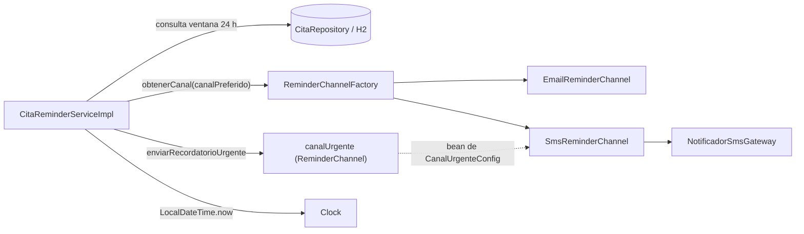

# Recordatorios Citas Service

[](https://github.com/DavidRincon12/rincon-post1-u9/actions/workflows/ci.yml)

Post-contenido de la Unidad 9 (Patrones de Diseño de Software): **Probar el diseño con JUnit 5, Mockito, Test Doubles e Integración Continua**. Un único proyecto Spring Boot 3.3 / Java 21 con las dos partes de la actividad.

## Descripción

Microservicio que envía recordatorios de citas médicas al paciente por su canal preferido (correo electrónico o SMS). Dos casos de uso:

- `enviarRecordatoriosPendientes()`: busca las citas que ocurren en las próximas 24 horas y no han sido notificadas, las notifica por su canal preferido y las marca como enviadas.
- `enviarRecordatorioUrgente(citaId)`: envía por SMS un aviso urgente para una cita concreta.

### Flujo de arquitectura



1. El servicio calcula la ventana con el `Clock` inyectado.
2. Consulta al repositorio las citas pendientes dentro de la ventana.
3. Por cada cita pide a la **Factory** el canal (**Strategy**) que corresponde y le entrega el mensaje.
4. Si el envío no lanza excepción, marca la cita como enviada y la guarda.
5. El recordatorio urgente usa el bean `canalUrgente`, construido una sola vez en el *composition root* (`CanalUrgenteConfig`).

Todos los colaboradores llegan por constructor (Principio de Inversión de Dependencias): el servicio solo conoce abstracciones.

### Estructura

```
src/main/java/com/clinica/recordatorios/
├── RecordatoriosCitasServiceApplication.java
├── domain/        Cita (entidad JPA), CanalNotificacion
├── repository/    CitaRepository
├── channel/       ReminderChannel (Strategy), Email/Sms, ReminderChannelFactory(+Impl)
│   └── gateway/   NotificadorSmsGateway, TwilioNotificadorSmsGateway
├── service/       CitaReminderService(+Impl), CitaNoEncontradaException
└── config/        ClockConfig, CanalUrgenteConfig (composition root)
src/test/java/com/clinica/recordatorios/
├── service/       CitaReminderServiceImplTest        (unitarias, Mockito)
├── repository/    CitaRepositoryTest                 (@DataJpaTest, H2)
└── CitaReminderServiceIntegrationTest                (@SpringBootTest, H2)
```

## Ejecutar las pruebas

Requisitos: JDK 21 y Maven 3.9+.

```bash
mvn test      # unitarias, @DataJpaTest y @SpringBootTest (fase test de Maven)
mvn verify    # compila, ejecuta toda la suite y empaqueta; es lo que corre el CI
```

El pipeline `.github/workflows/ci.yml` ejecuta `mvn -B verify` en Java 21 (Temurin) en cada push y pull request hacia `main`. No necesita contenedor de base de datos porque las pruebas de integración usan H2 en memoria.

### Evidencia de pruebas en verde

Salida de `mvn verify` (16 pruebas, 0 fallos):

```
Tests run: 3, Failures: 0, Errors: 0, Skipped: 0 -- in ...repository.CitaRepositoryTest
Tests run: 5, Failures: 0, Errors: 0, Skipped: 0 -- in ...CitaReminderServiceIntegrationTest
Tests run: 8, Failures: 0, Errors: 0, Skipped: 0 -- in ...service.CitaReminderServiceImplTest
Tests run: 16, Failures: 0, Errors: 0, Skipped: 0
BUILD SUCCESS
```

## Decisiones de diseño

### 1. Por qué Strategy facilitó las pruebas

Sin `ReminderChannel` como interfaz, la lógica de envío (SMTP o SMS) estaría escrita en línea dentro del servicio. Probar la selección de canal exigiría mockear librerías de bajo nivel (cliente SMTP, cliente HTTP) en lugar de una sola interfaz propia con un método `enviar()`.

Con Strategy, un `@Mock ReminderChannel` basta para verificar cualquier canal: la prueba `enviarRecordatoriosPendientes_citaEnVentana_usaElCanalPreferido` comprueba con `verify(reminderChannelMock).enviar(eq(cita), anyString())` que el servicio entregó el mensaje, sin tocar SMTP ni HTTP. Además `enviarRecordatoriosPendientes_canalFalla_noMarcaLaCitaComoEnviada` simula el fallo de cualquier canal con un solo `doThrow`.

### 2. Por qué Factory facilitó las pruebas

Sin `ReminderChannelFactory`, el servicio tendría un `if/else` o un `switch` embebido que decide el canal, y esa decisión solo se podría observar de forma indirecta (qué se imprimió o qué se envió realmente). Con la Factory inyectada, la selección es una interacción explícita y controlable:

- `when(reminderChannelFactory.obtenerCanal(EMAIL)).thenReturn(reminderChannelMock)` decide qué canal recibe la cita.
- `enviarRecordatoriosPendientes_variasCitasConCanalesDistintos_pideCadaCanalSegunLaCita` comprueba que cada cita llega a su canal.
- `enviarRecordatoriosPendientes_sinCitasPendientes_noConsultaLaFactory` usa `verifyNoInteractions(reminderChannelFactory)`.

### 3. Elección de Test Doubles en la Parte 1 (Mock vs. Stub vs. Fake)

| Colaborador | Double | Justificación |
|---|---|---|
| `CitaRepository` | **Mock** | No basta con *stubear* `findByFechaHoraCita...` para que devuelva una lista: también hay que **verificar** que `save()` se invoca exactamente una vez y con la cita marcada como enviada (y que no se invoca si no hay citas o si el canal falla). Cuando una prueba necesita controlar la respuesta y verificar la interacción, es un Mock y no un simple Stub. |
| `ReminderChannelFactory` / `ReminderChannel` | **Mock** | El comportamiento bajo prueba es precisamente la selección de la estrategia: que el servicio pida el canal correcto y que ese canal reciba el mensaje. Eso solo se comprueba verificando la interacción, no con un valor de retorno. |
| `Clock` | **Fake** (`Clock.fixed(...)`) | `Clock.fixed` es una implementación real y completa de `java.time.Clock` provista por el JDK: `LocalDateTime.now(clock)` funciona exactamente como en producción, con el instante congelado. Mockear `Clock` obligaría a stubbear `instant()` y `getZone()` por separado y a arriesgarse a que no se comporte como un reloj real. Con el fake, la ventana se afirma con valores exactos (`2026-08-10T09:00` → `2026-08-11T09:00`), reproducibles en cualquier máquina. |

En la Parte 2, la misma lógica explica la prueba de integración: **H2** es un Fake aceptable de la base real (contrato SQL/JPA equivalente, sin infraestructura), mientras que el proveedor de SMS no tiene un equivalente gratuito y determinista, así que se reemplaza con un **Mock** (`@MockBean NotificadorSmsGateway`) para no depender de credenciales, red ni disponibilidad del proveedor en el CI.

### 4. Diagnóstico del `new` hardcodeado y refactor DIP (Parte 2)

**Antes** (commit `feat(service): agrega enviarRecordatorioUrgente con new hardcodeado`):

```java
@Override
public void enviarRecordatorioUrgente(Long citaId) {
    Cita cita = citaRepository.findById(citaId)
            .orElseThrow(() -> new CitaNoEncontradaException(citaId));

    ReminderChannel canalUrgente = new SmsReminderChannel(new TwilioNotificadorSmsGateway()); // <- aquí
    canalUrgente.enviar(cita, MENSAJE_URGENTE);

    cita.setRecordatorioEnviado(true);
    citaRepository.save(cita);
}
```

**Diagnóstico.** La línea responsable es la construcción con `new` dentro del cuerpo del método. El servicio (módulo de alto nivel) depende de las clases concretas `SmsReminderChannel` y `TwilioNotificadorSmsGateway` y además es quien decide cómo crearlas: viola DIP. Consecuencia práctica: no existe ningún punto de sustitución. En una prueba unitaria no se puede simular "el gateway de SMS falla, por lo tanto la cita no debe marcarse como enviada", y ejecutar el método llamaría al gateway real. Se podría interceptar el `new` con `Mockito.mockConstruction()`, pero eso trata el síntoma con una herramienta más potente: el problema es de diseño, no de la herramienta.

Contraste con `enviarRecordatoriosPendientes()`, que sí era testeable desde la Parte 1: recibe `ReminderChannelFactory` por constructor, así que la prueba entrega un mock y controla qué canal se usa.

**Después** (commit `refactor(service): inyecta canalUrgente por constructor`):

```java
// config/CanalUrgenteConfig.java (composition root: el único new del canal)
@Bean
public ReminderChannel canalUrgente(NotificadorSmsGateway gateway) {
    return new SmsReminderChannel(gateway);
}

// service/CitaReminderServiceImpl.java
public CitaReminderServiceImpl(CitaRepository citaRepository,
                               ReminderChannelFactory reminderChannelFactory,
                               @Qualifier("canalUrgente") ReminderChannel canalUrgente,
                               Clock clock) { ... }

@Override
public void enviarRecordatorioUrgente(Long citaId) {
    Cita cita = citaRepository.findById(citaId)
            .orElseThrow(() -> new CitaNoEncontradaException(citaId));

    canalUrgente.enviar(cita, MENSAJE_URGENTE);
    cita.setRecordatorioEnviado(true);
    citaRepository.save(cita);
}
```

La solución no es eliminar el `new` (alguien tiene que construir el objeto concreto), sino moverlo al único lugar donde es correcto: la configuración de Spring. El servicio ahora depende de la abstracción `ReminderChannel`, y el comportamiento externo no cambió.

**Qué habilitó.** La prueba `enviarRecordatorioUrgente_gatewayFalla_noMarcaComoEnviado` sustituye `canalUrgente` por un mock que lanza una excepción y verifica con `verify(citaRepository, never()).save(any())` y `assertFalse(cita.isRecordatorioEnviado())` que la cita no se marca como enviada. Esa prueba era imposible de escribir antes del refactor: la testabilidad es consecuencia directa de aplicar DIP. En el contexto completo de Spring, `CitaReminderServiceIntegrationTest` reutiliza el mismo bean `canalUrgente` con `@MockBean NotificadorSmsGateway`.

### Mapa patrón → prueba

| Patrón / principio | Qué facilita | Prueba |
|---|---|---|
| Strategy (`ReminderChannel`) | Verificar el envío sin tocar SMTP/HTTP; simular fallos de canal | `..._usaElCanalPreferido`, `..._canalFalla_noMarcaLaCitaComoEnviada` |
| Factory Method (`ReminderChannelFactory`) | Controlar y verificar la selección de canal | `..._variasCitasConCanalesDistintos_...`, `..._sinCitasPendientes_noConsultaLaFactory` |
| Inyección de `Clock` (DIP) | Ventana de 24 h determinista | `..._ventanaDeterministaSegunClockFijo_consultaLosLimitesExactos` |
| Refactor DIP (`canalUrgente`) | Simular el fallo del gateway en el envío urgente | `enviarRecordatorioUrgente_gatewayFalla_noMarcaComoEnviado` |
| Repositorio Spring Data + H2 | Validar la consulta derivada contra una BD real | `CitaRepositoryTest` |
| Contexto completo + `@MockBean` | Flujo de punta a punta sin proveedor externo | `CitaReminderServiceIntegrationTest` |

## Herramientas utilizadas

- Java 21, Spring Boot 3.3, Spring Data JPA, H2, Lombok
- JUnit 5, Mockito, Spring Boot Test
- Apache Maven, GitHub Actions, Git, GitHub

## Conclusiones

Diseñar con Strategy, Factory e inyección por constructor desde el inicio dejó el servicio listo para probarse en aislamiento con muy pocos dobles: un mock por colaborador de comportamiento y un `Clock.fixed` como fake. El caso del `new` hardcodeado mostró que la dificultad para probar es un síntoma de diseño: mover la construcción al composition root resolvió el problema sin herramientas avanzadas y abrió la prueba del fallo del gateway. Elegir bien el tipo de double (mock cuando importa la interacción, fake cuando existe una implementación real y fiel) vuelve las pruebas más simples y deterministas. Por último, usar H2 en las pruebas de integración mantiene el CI sencillo, sin contenedores de base de datos.
